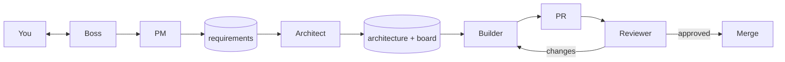
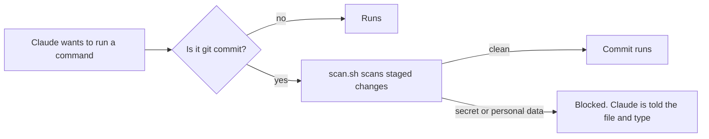
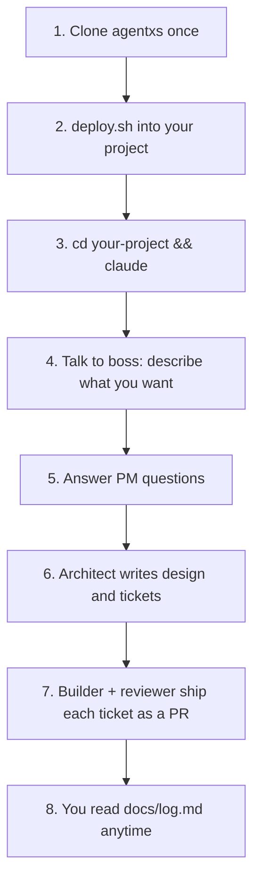

# agentxs

Extra-small team of AI agents that turns an idea into reviewed, tested code. Six roles, plain files, no server.



## Roles

| Role | Does | Output |
|------|------|--------|
| Boss | Talks to you, runs the others | `docs/log.md` |
| PM | Asks you questions | `docs/requirements.md` |
| Architect | Designs, splits into phases | `docs/architecture.md`, `docs/board.md` |
| Builder | One ticket: tests first, code, PR | Pull request |
| Reviewer | Technical + functional review | Approve / send back |
| Retro | Looks at how we work | `docs/retro.md` |

## Tech stack

Not chosen yet. The architect picks it from the requirements and records it in `docs/architecture.md`.

## Tools you need

| Tool | Why | Install (macOS) |
|------|-----|-----------------|
| [Claude Code](https://claude.com/claude-code) | Runs the agents | see Claude Code docs |
| `git` | Branches, commits, pull requests | `xcode-select --install` or `brew install git` |
| GitHub CLI `gh` | Opens PRs, posts reviews, merges. Run `gh auth login` once. | `brew install gh` |
| `jq` | Reads the JSON that Claude Code gives to hooks (see below) | `brew install jq` |
| `gitleaks` (optional) | Stronger secret scan on every commit | `brew install gitleaks` |

**What is `jq`?** A command-line tool that reads JSON and pulls out or builds pieces of it, like `grep` for JSON:

```bash
echo '{"name":"agentxs","tags":["ai","agents"]}' | jq -r '.name'
# agentxs
```

The hooks use it to read what Claude is about to run (so the commit guard knows a `git commit` is coming), to read the transcript path (so the ralph loop can see what Claude last said), and to send back the "keep going" message. `deploy.sh` checks for `jq` and tells you if it is missing. No `jq`, no guards and no ralph loop.

## Share it

Get agentxs from GitHub:

```bash
git clone https://github.com/ran1979/agentxs.git
cd agentxs
```

Then install it into a project (see below). Pull updates any time with `git pull`.

## Install into a project

Requirements: [Claude Code](https://claude.com/claude-code), `git`, `jq`, GitHub CLI (`gh`) logged in. The project must be a git repo with an `origin` remote (deploy.sh warns if not). Windows: use WSL.

```bash
# copy (snapshot, default, safe to commit and share)
./deploy.sh ~/path/to/your-project

# symlink (edits in this repo show up in the project; this machine only)
./deploy.sh ~/path/to/your-project --symlink
```

Do not commit a project that was installed with `--symlink`: the links point to this checkout and break on other machines.

This installs:

| Path in your project | Copy mode | Symlink mode |
|----------------------|-----------|--------------|
| `.claude/agents/*.md` | copied, refreshed on re-run | linked |
| `.claude/skills/*/` | copied, refreshed on re-run | linked |
| `CLAUDE.md` | copied once (never overwritten) | linked once |
| `.claude/settings.json` | copied once: permissions and hooks (see Guardrails). If you already have one, merge it by hand or the guards and ralph loop stay off. | linked once |
| `.claude/hooks/*.sh` | copied, refreshed on re-run | linked |
| `.claude/guard-terms.txt` | copied once: add your own names and IDs | linked once |
| `.gitignore` | adds `.claude/ralph/` and `.agentxs-backup/` | adds the same lines |
| `docs/*.md` | standard templates, created once | standard templates, created once |

Re-run `deploy.sh` any time to update agents, skills, and hooks. Project `docs/` and an existing `CLAUDE.md` are never overwritten.

If your project already has a `.claude/agents/` or `.claude/skills/` file with the same name and different content, deploy moves your copy to `.agentxs-backup/` (git-ignored) before replacing it.

**Check the install** (changes nothing):

```bash
./deploy.sh --check ~/path/to/your-project
```

It lists each piece as `ok` or `FAIL`. Fix the FAIL lines and re-run.

**Restart Claude Code** after install or any hook change. Hooks may not reload in a session that is already running.

**Try it safely first:** make a throwaway project (`mkdir /tmp/agentxs-try && cd /tmp/agentxs-try && git init && git remote add origin <a test repo>`), install into it, and try `explain` and `assist` before `ship`.

## Modes

Boss picks one from your first message:

| Mode | Say something like | What you get |
|------|--------------------|--------------|
| **explain** | "explain this file", "how does X work" | Plain explanation and diagram. No files written. Good for interview prep. |
| **assist** | "fix this", "add a small…" | A quick, small change to your code. No PR pipeline. |
| **ship** | "build X" | Full pipeline: requirements, design, tickets, PRs, review, merge. |

See `examples/todo-api/` for a finished `ship` run.

## Guardrails

Enforced by hooks, not just by instructions:

| Guard | What it does |
|-------|--------------|
| Commit scan | Before every `git commit`: finds keys, tokens, passwords, emails, phone and card numbers, and your own terms (`.claude/guard-terms.txt`). A hit blocks the commit and boss tells you the file and type. The value is never printed. |
| Secret files | Claude cannot read `.env*`, `*.pem`, `*.key`, `id_rsa*`, `secrets/`. |
| Push and merge | Builders may push `ticket/*` branches without asking, so ralph can run unattended. Pushes to `main`, `gh pr merge`, and any other push ask you. Force-push and `rm -rf` are denied. |
| Reviewer | Scans the whole PR diff again, checks security basics and new dependencies. |

Already-committed secrets or personal data are not fixed by the guard. Rotate or rewrite history yourself. Boss will not do that.

### How the guards work

Claude Code reads `.claude/settings.json` in your project. It holds two kinds of rules:

- **permissions**: what Claude may run without asking (`allow`), what asks you first (`ask`), what is never allowed (`deny`).
- **hooks**: scripts Claude Code runs at fixed moments. Each hook gets JSON about what is happening and can block it.

agentxs uses two hooks:



| File | Role |
|------|------|
| `.claude/settings.json` | Permissions and which hook runs when |
| `.claude/hooks/guard-commit.sh` | Runs before each Bash command; passes only `git commit` on to the scan |
| `.claude/hooks/scan.sh` | The scan: regex rules, your terms, and gitleaks if installed |
| `.claude/guard-terms.txt` | Your own names, usernames, and IDs, one per line |

You can run the scan yourself, any time:

```bash
.claude/hooks/scan.sh                        # staged changes
.claude/hooks/scan.sh origin/main...HEAD     # a whole branch
```

Exit code 0 means clean. Exit code 2 means something was found; the output names the file and type.

**Limits:** regex finds common patterns, not every secret. It can false-positive, so placeholders like `example.com` and `your-…` are skipped. Treat it as a net, not a guarantee.

## Ralph loop

Runs one phase of the board in a loop, until the phase is done or blocked. Each pass re-reads `docs/board.md`, so progress lives in files, not in the chat.

```
you: "ralph phase 1"        (cap defaults to 4)
  → boss runs builder → reviewer → merge for each ticket
  → Claude finishes a turn
  → the Stop hook (ralph-stop.sh) reads the transcript
  → no promise yet and cap not reached? the hook sends the same phase prompt back
  → promise <PHASE_DONE> or <BLOCKED>, or cap reached? the loop ends
```

- **State file**: `.claude/ralph/state.md` holds the iteration count, the cap, and the phase prompt. It is git-ignored.
- **Stop hook**: `.claude/hooks/ralph-stop.sh` runs every time Claude finishes a turn. Without a state file it does nothing, so normal use is unaffected.
- **Why one phase**: a phase is a bounded unit that ends for your review. The loop never runs past it.

Cancel any time: delete `.claude/ralph/state.md`. The default cap is 4 passes. Ask boss before raising it. Keep phases small: a phase that needs more passes should be split. Context grows across passes in the same session.

Test it on a throwaway project before a real phase. The hook contract comes from Claude Code's documented hook format; it has not been checked against every Claude Code version.

## How to use it

**Run `claude` inside your project, not inside the agentxs folder.** The project is where `docs/` lives and where the code gets written.



Step by step:

1. **Clone** agentxs (see Share it above).
2. **Install** into your project: `./deploy.sh ~/path/to/your-project`.
3. **Start** Claude in that project: `cd ~/path/to/your-project && claude`. You are now talking to **boss**. No command needed; boss rules load from `CLAUDE.md`.
4. **Say what you want to build**, in plain words. Boss starts the PM.
5. **PM asks questions**, one at a time. Answer them. Result: `docs/requirements.md`.
6. **Architect designs it**: options, diagrams, phases. Result: `docs/architecture.md` and tickets in `docs/board.md`. Read it, then tell boss to go ahead.
7. **Builder and reviewer work the tickets**: one ticket, one branch, one PR. Reviewer posts `APPROVED` or `CHANGES REQUESTED` as a PR comment. Boss merges only on `APPROVED`. (The gate is by convention: builder and reviewer share one GitHub account, so GitHub cannot enforce it. Use a separate reviewer account if you need a hard gate.)
8. **Follow along** in `docs/log.md`, which has a plain-language entry per step. Ask boss for more detail any time.
9. **Retro** after each phase: `/retro`. Proposes process changes; applies only what you approve.

## Where things are

```
agentxs repo:
  CLAUDE.md                 boss rules
  .claude/agents/           architect, builder, reviewer
  .claude/skills/           pm, retro, explain, ralph
  .claude/hooks/            commit guard, secret/PII scan, ralph stop hook
  templates/guard-terms.txt starter list for your own names and IDs
  examples/todo-api/        a finished ship-mode run to read
  templates/docs/           standard formats for project docs
  deploy.sh                 install into a project (copy or --symlink)

your project after install:
  CLAUDE.md                 boss rules (copied once)
  .claude/                  agents and skills
  docs/requirements.md      what to build
  docs/architecture.md      how, with diagrams and phases
  docs/board.md             tickets and status (everyone reads this)
  docs/log.md               plain-language history of every step
  docs/retro.md             what we changed and why
  .claude/settings.json     permissions and hooks
  .claude/hooks/            guards and ralph stop hook
  .claude/guard-terms.txt   your names and IDs for the scan
  .claude/ralph/state.md    only while a ralph loop runs (git-ignored)
```

## Definition of done

- Requirement acceptance met (reviewer checked)
- Tests written first and passing
- Coverage ≥ 75%
- Reviewer approved
- Merged

## Test and deploy

Filled in by the architect once the stack is chosen. The builder's first ticket sets up the test command and coverage check.

| Task | Command |
|------|---------|
| Test | TBD |
| Coverage | TBD (must fail below 75%) |
| Run locally | TBD |
| Deploy | TBD |

## Changing the process

Edit `CLAUDE.md` (boss rules) or a file in `.claude/agents/` or `.claude/skills/`. Run `/retro` to propose changes based on what happened.
