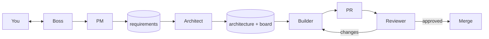

# agentxs

Extra-small team of AI agents that turns an idea into reviewed, tested code. Five roles, plain files, no server.



## Roles

| Role | Does | Output |
|------|------|--------|
| Boss | Talks to you, runs the others | `docs/log.md` |
| PM | Asks you questions | `docs/requirements.md` |
| Architect | Designs, splits into phases | `docs/architecture.md`, `docs/board.md` |
| Builder | One ticket: tests first, code, PR | Pull request |
| Reviewer | Technical + functional review | Approve / send back |
| Retro | Looks at how we work | `docs/retro.md` |

## Tech stack

Not chosen yet. The architect picks it from the requirements and records it in `docs/architecture.md`.

## Share it

Get agentxs from GitHub:

```bash
git clone https://github.com/ran1979/agentxs.git
cd agentxs
```

Then install it into a project (see below). Pull updates any time with `git pull`.

## Install into a project

Requirements: [Claude Code](https://claude.com/claude-code), `git`, GitHub CLI (`gh`) logged in.

```bash
# copy (snapshot, default)
./deploy.sh ~/path/to/your-project

# symlink (edits in this repo show up in every linked project)
./deploy.sh ~/path/to/your-project --symlink
```

This installs:

| Path in your project | Copy mode | Symlink mode |
|----------------------|-----------|--------------|
| `.claude/agents/*.md` | copied, refreshed on re-run | linked |
| `.claude/skills/*/` | copied, refreshed on re-run | linked |
| `CLAUDE.md` | copied once (never overwritten) | linked once |
| `docs/*.md` | standard templates, created once | standard templates, created once |

Re-run `deploy.sh` any time to update agents and skills. Project `docs/` and an existing `CLAUDE.md` are never overwritten.

## Quick start

```bash
cd ~/path/to/your-project
claude
```

Then tell the boss what you want to build. It will:

1. run `/pm` and ask you questions,
2. design and create tickets,
3. build tickets one by one, each in its own PR,
4. merge only after the reviewer approves.

## Where things are

```
agentxs repo:
  CLAUDE.md                 boss rules
  .claude/agents/           architect, builder, reviewer
  .claude/skills/           pm, retro
  templates/docs/           standard formats for project docs
  deploy.sh                 install into a project (copy or --symlink)

your project after install:
  CLAUDE.md                 boss rules (copied once)
  .claude/                  agents and skills
  docs/requirements.md      what to build
  docs/architecture.md      how, with diagrams and phases
  docs/board.md             tickets and status (everyone reads this)
  docs/log.md               plain-language history of every step
  docs/retro.md             what we changed and why
```

## Definition of done

- Requirement acceptance met (reviewer checked)
- Tests written first and passing
- Coverage ≥ 75%
- Reviewer approved
- Merged

## Test and deploy

Filled in by the architect once the stack is chosen. The builder's first ticket sets up the test command and coverage check.

| Task | Command |
|------|---------|
| Test | TBD |
| Coverage | TBD (must fail below 75%) |
| Run locally | TBD |
| Deploy | TBD |

## Changing the process

Edit `CLAUDE.md` (boss rules) or a file in `.claude/agents/` or `.claude/skills/`. Run `/retro` to propose changes based on what happened.
