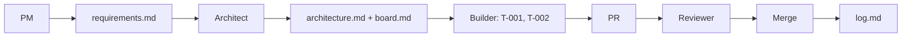

# Example: todo-api

A small, finished run of the agentxs `ship` mode, so you can see the output before you install anything. This is documentation only. It is not code you can run.

Read in this order:

1. [`docs/requirements.md`](docs/requirements.md) — what the PM wrote after asking questions
2. [`docs/architecture.md`](docs/architecture.md) — the architect's options, pick, and phases
3. [`docs/board.md`](docs/board.md) — tickets and their status
4. [`docs/log.md`](docs/log.md) — the plain-language record of each step

