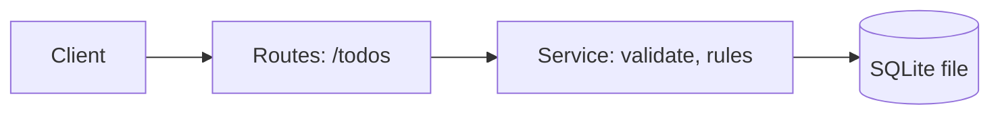

# Architecture

Status: approved
Requirements: docs/requirements.md

## Options
| Option | Idea | Pros | Cons | Pick when |
|--------|------|------|------|-----------|
| A | Express + in-memory array | Fastest to build, zero setup | Data lost on restart | Demo or first slice |
| B | Express + SQLite file | Survives restart, still no server | One more dependency | Real use on one machine |
| C | Express + Postgres | Scales, multi-user | Needs a server, more setup | Many users (out of scope) |

## Chosen: B
Keeps data across restarts with one file and no server. Option C is not needed for the requirements.

## Functional
- R-001, R-002, R-003: three routes in `routes.js`, rules in `service.js`.

## Non-functional
| Aspect | Target | How |
|--------|--------|-----|
| Performance | p95 < 200 ms at 1,000 items | Index on `id`; list query has no joins |
| Reliability | Data survives restart | SQLite file on disk |

## Tech stack
- Language / framework: Node.js 20, Express 4
- Test runner + coverage tool: Jest, with `--coverage` (fails below 75%)
- Deploy target: any Node host (not in scope for this example)

## Phases
- Phase 1: T-001 test setup, T-002 create and list (R-001, R-002)
- Phase 2: T-003 mark done (R-003), T-004 load check (R-004)

## Missing context / risks
- Load check (R-004) depends on the test machine. Compare on the same machine each time.
