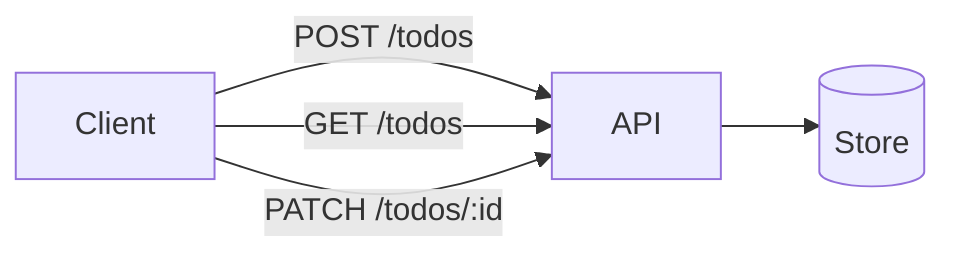

# Requirements

Status: approved
Last updated: 2026-10-16

## Goal
A small web API so one user can create, list, and complete to-do items.

## Requirements
| ID | Requirement | Type | Priority | Acceptance (pass/fail) |
|----|-------------|------|----------|------------------------|
| R-001 | Create a to-do with a title | functional | must | POST /todos with `{"title":"x"}` returns 201 and the item. Empty title returns 400. |
| R-002 | List all to-dos | functional | must | GET /todos returns the array, oldest first. |
| R-003 | Mark a to-do done | functional | must | PATCH /todos/:id with `{"done":true}` returns 200. Unknown id returns 404. |
| R-004 | Respond in under 200 ms for up to 1,000 items | non-functional | should | Load test with 1,000 items: p95 under 200 ms. |

Rules: IDs never change. Deleted requirements become `dropped`. Priority: `must`, `should`, `could`.

## Out of scope
- Users and login
- Deleting to-dos
- A web page (API only)

## Flows

## Open questions
- None for this example.
