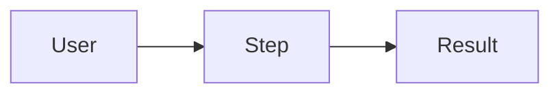

# Requirements

Status: draft | approved
Last updated: YYYY-MM-DD

## Goal
One or two sentences.

## Requirements
| ID | Requirement | Type | Priority | Acceptance (pass/fail) |
|----|-------------|------|----------|------------------------|
| R-001 | … | functional | must | … |
| R-002 | … | non-functional | should | … |

Rules: IDs never change. Deleted requirements become `dropped`. Priority: `must`, `should`, `could`.

## Out of scope
- …

## Flows

## Open questions
- OPEN: …
